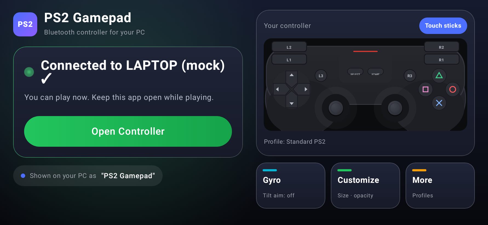
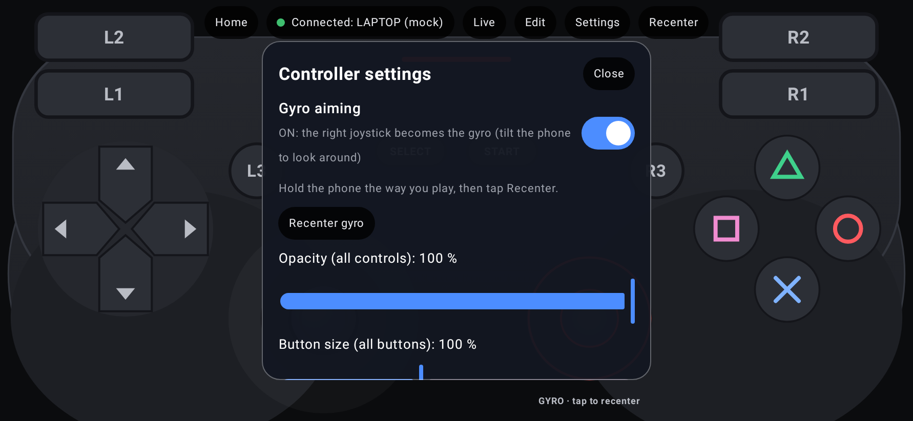
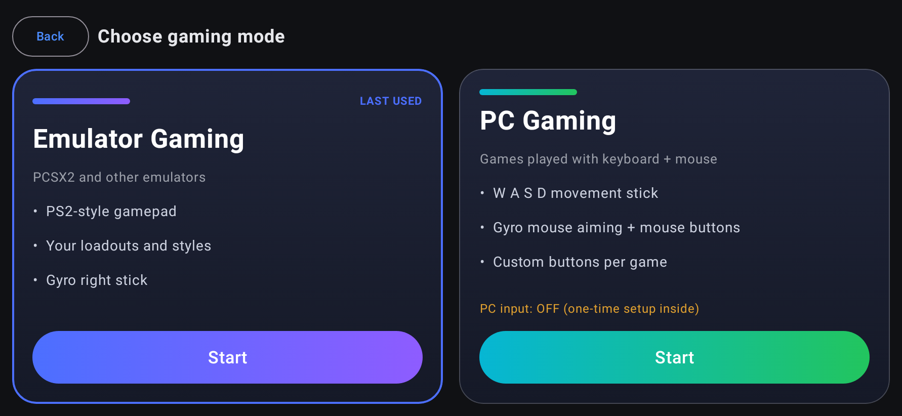
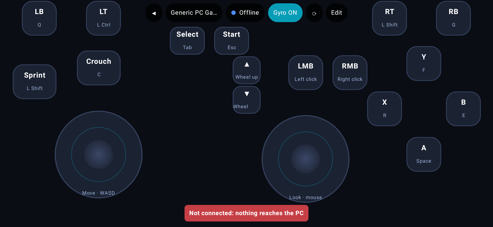
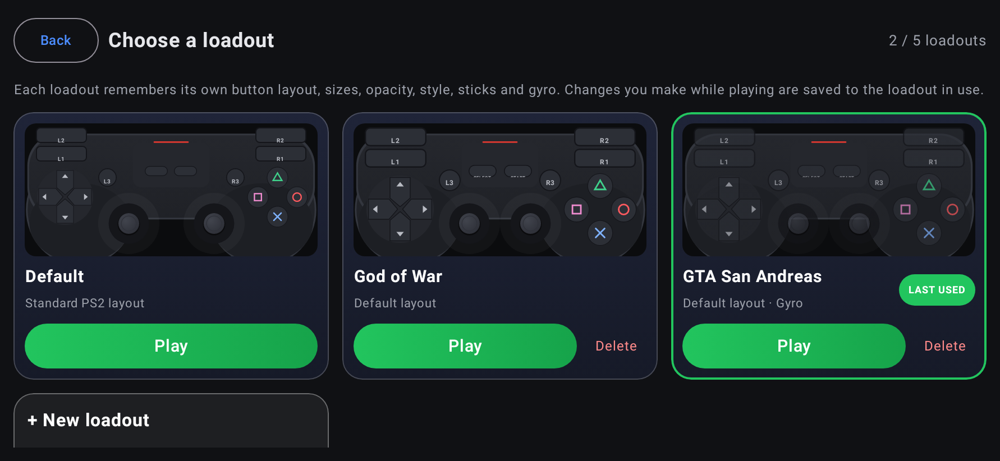
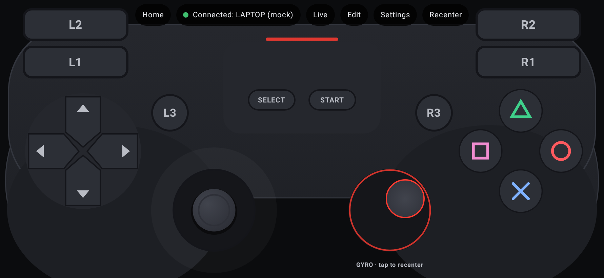

# PS2 Bluetooth Gamepad (Android → Windows / PCSX2)

## 📥 Download

### **[⬇️ Download the APK (v1.6.0, 2.7 MB)](download/PS2BluetoothGamepad.apk?raw=true)**

**Install on your phone:**
1. Open this page on your Android phone and tap the download link above.
2. Open the downloaded `PS2BluetoothGamepad.apk` (from the notification or the Downloads folder).
3. If asked, allow **"Install unknown apps"** for your browser or file manager, then tap **Install**.
   Android or Play Protect may warn that the app is from an unknown developer, because it isn't
   from the Play Store. Choose **Install anyway**.
4. Open **PS2 Bluetooth Gamepad** and follow the one instruction on the screen:
   - **Allow** Bluetooth access, then the app sets itself up and renames the phone to **"PS2 Gamepad"**.
   - First time: tap **Make phone visible to PC**, then on the laptop go to Settings → Bluetooth & devices →
     Add device → Bluetooth → **PS2 Gamepad**, and confirm the code on both screens.
   - Next times: just open the app with Bluetooth on (phone and laptop); it connects by itself.
   - When it says **Connected ✓**, tap **Open Controller**.
   - If the phone was paired with the laptop *before*, remove it in Windows Bluetooth settings first and pair again.

Requires Android 9 or newer with Bluetooth.

### Screens

| Home | Settings inside the controller |
|---|---|
|  |  |
| **Mode selection** | **PC Gaming controller** |
|  |  |
| **Loadouts (one per game)** | **Controller with gyro** |
|  |  |

SHA-256: `a398c78caef7e35d20608b27d80fd8367ed7a86fe02c4d816b0e300671039448`

---

An Android app that turns a phone into a **Bluetooth HID gamepad** with a DualShock 2-style touch
layout. Windows sees a standard game controller (no driver, no PC software), so PCSX2 and other
games can use it like any other pad.

**Version 1.0.0.** Status: feature-complete and covered by 181 automated tests (179 passed, 2 skipped).
**No test has yet been run on the POCO F6 + Windows 11.** Hardware results, game compatibility and
end-to-end latency are therefore all *unverified*. See [TEST_REPORT.md](TEST_REPORT.md).

| Document | Contents |
|---|---|
| [INSTALLATION.md](INSTALLATION.md) | Install the APK, debug vs release builds, building from source |
| [BLUETOOTH_SETUP.md](BLUETOOTH_SETUP.md) | Compatibility findings, pairing with Windows, joy.cpl, troubleshooting |
| [PCSX2_CONFIGURATION.md](PCSX2_CONFIGURATION.md) | Button/axis mapping and PCSX2 binding |
| [TEST_REPORT.md](TEST_REPORT.md) | Automated results, what is mocked, the hardware test procedure |
| [BUG_REPORT.md](BUG_REPORT.md) | Every bug found, its root cause, fix and regression test |
| [RELEASE_NOTES.md](RELEASE_NOTES.md) | 1.0.0 contents and known limitations |
| [DEVELOPMENT_PROGRESS.md](DEVELOPMENT_PROGRESS.md) | Phase-by-phase history and remaining work |

## Features

- **Bluetooth HID gamepad** using Android's public `BluetoothHidDevice` API (Android 9+):
  12 buttons, D-pad (hat switch) and two analog sticks. One fixed report, so the PC never needs re-pairing.
- **DualShock 2 layout:** D-pad, △ ○ ✕ □, L1 L2 R1 R2, Start, Select, L3, R3 and two analog sticks.
  Full multi-touch with per-finger tracking.
- **Never-stuck inputs:** everything is released on lift, cancel, app pause, focus loss,
  notification shade, back, profile switch, layout editing, Bluetooth off and connection loss.
  A failed report is retried with the current state.
- **Two modes:** *Emulator Gaming* (unchanged PS2 controller) and **PC Gaming**: Bluetooth keyboard +
  mouse with a W/A/S/D stick, gyro mouse aiming, mouse buttons, wheel, custom buttons (key combos too)
  and PC game profiles. See [PC_MODE.md](PC_MODE.md). Windows test pending.
- **Loadouts (up to 5):** one saved setup per game. Each keeps its own button layout, sizes,
  opacity, sticks and gyro. Open Controller asks which loadout to play; create one, arrange the
  buttons, Save, and next time just pick it.
- **Gyro right stick (360°):** tilt the phone to move the right stick like a real analog stick:
  any direction, any intermediate angle, held tilt = held stick, back to neutral = centre.
  Gyroscope + accelerometer fusion (no drift), Recenter / Calibrate, sensitivity, max tilt angle,
  dead zone, smoothing, invert X/Y, and a live test screen showing exactly what is sent.
- **Settings inside the controller** (Settings button): gyro on/off (on = the right joystick
  becomes the gyro), opacity of all controls, size of all buttons, joystick size.
- **Customization:** button size, stick size, opacity of all controls **and of each control**, controller opacity,
  face-button spacing, 4 backgrounds, labels, haptics.
- **Layout editor:** drag, resize and reset controls; overlapping drops are refused; layouts adapt to any screen size.
- **Profiles:** Standard PS2, God of War, God of War II, GTA San Andreas, NFS Most Wanted, Custom,
  plus your own (create, rename, duplicate, delete, restore). Profiles never change the button mapping.
- **Analog settings per stick:** sensitivity, dead zone, max range, response curve, invert Y,
  fixed/floating centre, centre calibration with a live X/Y visualizer.
- **Dashboard:** connection status and timer, last connection, active profile, phone battery, quick access to every screen.
- **Diagnostics:** every input live, the last HID report, measured report rate, report generation time,
  touch→send time, app CPU %, heap, session battery change.

## Technology

Kotlin 2.1 · Jetpack Compose (BOM 2025.05) · Material 3 · coroutines/StateFlow · MVVM ·
Jetpack DataStore + kotlinx-serialization · AGP 8.13 · minSdk 28, targetSdk 35 · R8 for release.
Tests: JUnit 4, kotlinx-coroutines-test, Robolectric 4.14 + Compose UI test.

## Architecture

```
 Touch (Compose) ──► per-control pointer tracking (ui/controller/PointerTracking.kt)
        │                 D-pad · face cluster · sticks (StickMath) · buttons
        ▼
 ControllerInputManager  ── single source of truth for the controller state, locked,
        │                   dedups, releaseAll() + reset epoch invalidates stale fingers
        ▼  HidReportManager.encode()  (6-byte report, Report ID 1)
 HidDeviceManager        ── BluetoothHidDevice proxy · registerApp · callbacks (own thread)
        │                   sender thread: 4 ms pacing, axis-only coalescing, retry on failure
        ▼
   Android Bluetooth stack ──► Windows HID game controller ──► PCSX2 (SDL / DInput)

 MainViewModel  ── connects UI, input manager, HID state machine (HidStateReducer), lifecycle
                   (pause/stop/focus → release), reconnect, profiles (SettingsRepository → DataStore)
```

Source layout: `bluetooth/` (HID layer), `controller/` (input manager, stick maths, layout engine),
`model/`, `settings/` (profiles, persistence), `permissions/`, `ui/` (screens), `ui/controller/` (controller UI).

## Quick start

1. Install `release/PS2BluetoothGamepad-1.0.0-release.apk` ([INSTALLATION.md](INSTALLATION.md)).
2. Open the app → Connection → Grant permission → **Register HID Device** → **Make discoverable**.
3. Windows → Bluetooth → Add device → pick the phone → confirm the code.
4. Check `joy.cpl`, then **Open Controller** and bind it in PCSX2 ([PCSX2_CONFIGURATION.md](PCSX2_CONFIGURATION.md)).

## Known limitations

- **Keep the app in the foreground.** Android unregisters HID apps that go to the background;
  the app re-registers when you return. The controller screen keeps the display on.
- L2/R2 are digital (no pressure). Sticks are 8-bit with a circular range (diagonal ≈ ±90 per axis).
- No vibration (the HID report has no output/rumble report).
- Only one app on the phone can be a HID device at a time.
- Earbuds on the phone play phone audio only; PC game audio is not forwarded.
- Game profiles are tuning starting points, not tested presets.
