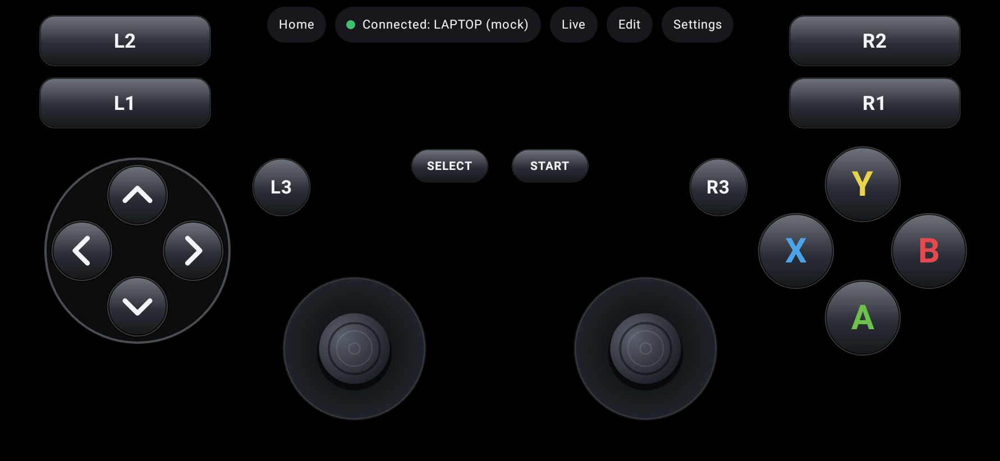
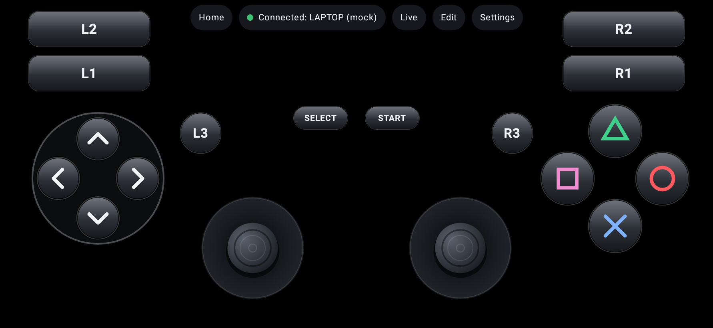
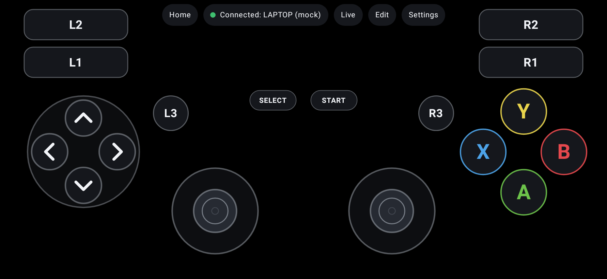
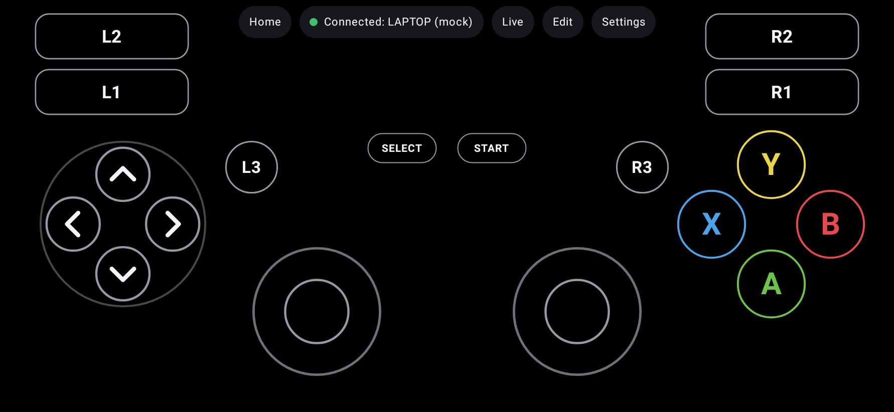
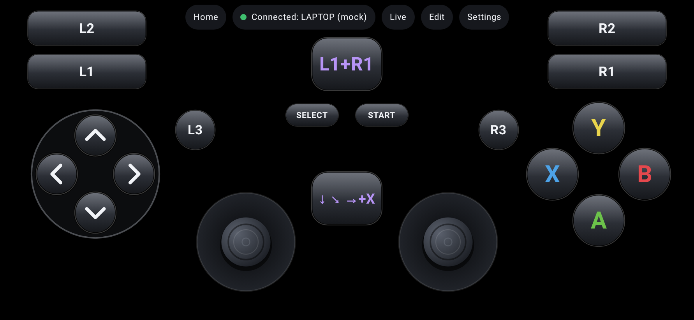
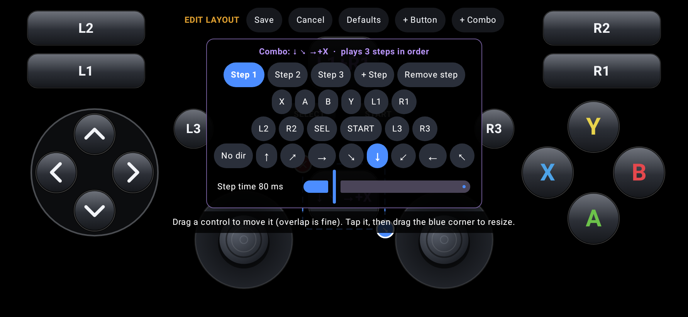

# PadLink: your phone as a Bluetooth controller

**PadLink** turns an Android phone into a simple **Bluetooth game controller** for a Windows PC. Windows
sees a normal game controller, so PCSX2 and other emulators can use it. No PC software and no driver
needed.

- Buttons in **3 styles**: **Real** (3D like a physical pad), **Simple** (flat) or **Outline** (rings only)
- Face buttons labelled **Y B A X** or **△ ○ ✕ □**
- **Combo buttons**: press several buttons together (e.g. L1+R1), or play a sequence (e.g. ↓ ↘ → + X)
- **Pure black background**: on AMOLED phones black pixels are switched off, which saves battery
- Move, resize and add buttons freely, with up to 5 **loadouts** (one per game)

## 📲 Install on your phone

1. Open this page on your Android phone and tap the **Download** link at the [bottom of this page](#-download).
2. Open the downloaded `PadLink.apk` (from the notification or the Downloads folder).
3. If asked, allow **"Install unknown apps"** for your browser or file manager, then tap **Install**.
   Android or Play Protect may warn that the app is from an unknown developer, because it isn't
   from the Play Store. Choose **Install anyway**.
4. Open **PadLink** and follow the one instruction on the screen:
   - **Allow** Bluetooth access. The app then sets itself up and renames the phone to **"PadLink"**.
   - First time: tap **Make phone visible to PC**. On the laptop, go to Settings → Bluetooth & devices →
     Add device → Bluetooth → **PadLink**, and confirm the code on both screens.
   - After that, just open the app with Bluetooth on (phone and laptop). It connects by itself.
   - When it says **Connected ✓**, tap **Open Controller** and pick a loadout.
   - **Updating from an older version:** remove the phone in Windows Bluetooth settings and pair it
     again once. Windows may still show the old name "PS2 Gamepad" until you do.

Requires Android 9 or newer with Bluetooth.

### Screens

| Real buttons (Y B A X) | Real buttons (△ ○ ✕ □) |
|---|---|
|  |  |
| **Simple buttons** | **Outline buttons** |
|  |  |
| **Combo buttons** | **Making a combo (Edit)** |
|  |  |
| **Settings inside the controller** | **Loadouts (one per game)** |
|  |  |

---

**Version 3.0.0.** 244 automated tests (242 passed, 2 skipped).
- Confirmed on real hardware by the developer (POCO F6 + Windows 11): registration, pairing,
  Windows game controller test (`joy.cpl`), PCSX2 with manual binding.
- Not yet confirmed on hardware: button styles, combo buttons, loadouts and the battery saver.
  See [TEST_REPORT.md](TEST_REPORT.md).

## 🎮 Works with emulators

Windows sees PadLink as a standard (DirectInput / HID) game controller with 12 buttons, a D-pad and
two analog sticks. Bind it once in the emulator's controller settings:

- **PCSX2** (PS2): Settings → Controllers → bind each button ([PCSX2_CONFIGURATION.md](PCSX2_CONFIGURATION.md)).
- **RetroArch, PPSSPP, DuckStation, Dolphin** and other emulators with generic controller support:
  pick "PadLink" in their controller settings and bind the buttons.
- Check it first in Windows: press Win+R → `joy.cpl` → PadLink → Properties, and press buttons.
- Games that only accept Xbox (XInput) controllers don't see a generic controller. Add the game to
  **Steam** and turn on Steam Input for generic controllers, or use a tool such as x360ce.

## 🧩 Combo buttons

In the controller tap **Edit → + Combo**, then choose what the combo presses:

- **One step** (e.g. **L1+R1**): all its buttons are pressed together while you hold the combo button.
  All the buttons reach the PC in the same report.
- **Several steps** (tap **+ Step**, e.g. **↓ ↘ → + X**): each tap plays the steps in order. **Step time**
  sets how long each step is held (30–300 ms). If a step repeats a button from the step before, the
  combo releases it briefly first, so the game sees a new press.
- Each step can hold any of the 12 buttons plus one D-pad direction. Drag the combo button anywhere,
  resize it with the blue corner, and delete it with the red ✕. Press **Save**.

## 🔋 Battery and heat

- **Pure black background** everywhere: AMOLED pixels stay off, and only the buttons light up.
  **Outline** buttons light up the fewest pixels.
- **Battery saver** is ON by default (controller → Settings). While the controller is open, it limits
  the screen to **60 Hz** instead of 90/120 Hz and sends Bluetooth reports at **125 Hz** instead of 250 Hz
  (at most 4 ms later). Brightness is left to you: lower it with the phone's normal slider.
- No background work: the Bluetooth sender sleeps until a button changes.

| Document | Contents |
|---|---|
| [INSTALLATION.md](INSTALLATION.md) | Install the APK, debug vs release builds, building from source |
| [BLUETOOTH_SETUP.md](BLUETOOTH_SETUP.md) | Compatibility findings, pairing with Windows, joy.cpl, troubleshooting |
| [PCSX2_CONFIGURATION.md](PCSX2_CONFIGURATION.md) | Button/axis mapping and PCSX2 binding |
| [TEST_REPORT.md](TEST_REPORT.md) | Automated results, what is mocked, the hardware test procedure |
| [BUG_REPORT.md](BUG_REPORT.md) | Every bug found, its root cause, fix and regression test |
| [RELEASE_NOTES.md](RELEASE_NOTES.md) | What changed in each version |
| [DEVELOPMENT_PROGRESS.md](DEVELOPMENT_PROGRESS.md) | Phase-by-phase history |

## Features

- **Bluetooth HID gamepad** using Android's public `BluetoothHidDevice` API (Android 9+):
  12 buttons, D-pad (hat switch) and two analog sticks, in one fixed report.
- **Layout:** D-pad, four face buttons (each one separate), L1 L2 R1 R2, Start, Select, L3, R3 and
  two analog sticks. Full multi-touch with per-finger tracking.
- **Button styles:** Real, Simple or Outline, and Y B A X or △ ○ ✕ □ labels. Only the look changes:
  every style sends the same buttons, so emulator bindings stay.
- **Combo buttons:** pressed together or played as a sequence (see above). Up to 12 added buttons and
  combos per loadout, 8 steps per combo.
- **Never-stuck inputs:** everything is released on lift, cancel, app pause, focus loss,
  notification shade, back, loadout switch, layout editing, Bluetooth off and connection loss.
  A failed report is retried with the current state.
- **Loadouts (up to 5):** one saved setup per game. Each keeps its own layout, sizes, opacity,
  button style, sticks and combo buttons.
- **Layout editor:** drag any control, resize it with the blue corner handle, overlap allowed,
  extra buttons (a second Cross, for example) and combos. Layouts adapt to any screen size.
- **Settings inside the controller:** button style, face labels, battery saver, opacity of all
  controls, button size, joystick size.
- **Customization:** opacity of each control, face-button spacing, labels, haptics.
- **Analog settings per stick:** sensitivity, dead zone, max range, response curve, invert Y,
  fixed/floating centre, centre calibration with a live X/Y visualizer.
- **Diagnostics:** every input live, the last HID report, measured report rate and timing.

## Technology

Kotlin 2.1 · Jetpack Compose (BOM 2025.05) · Material 3 · coroutines/StateFlow · MVVM ·
Jetpack DataStore + kotlinx-serialization · AGP 8.13 · minSdk 28, targetSdk 35 · R8 for release.
Tests: JUnit 4, kotlinx-coroutines-test, Robolectric 4.14 + Compose UI test.

## Architecture

```
 Touch (Compose) ──► per-control pointer tracking (ui/controller/PointerTracking.kt)
        │                 D-pad · face buttons · sticks (StickMath) · buttons · combo buttons
        ▼
 ControllerInputManager  ── single source of truth for the controller state, locked; each
        │                   button/direction is held per control (combos never cut a real press)
        ▼  HidReportManager.encode()  (6-byte report, Report ID 1)
 HidDeviceManager        ── BluetoothHidDevice proxy · registerApp · callbacks (own thread)
        │                   sender thread: 4 ms pacing (8 ms in battery saver), axis-only coalescing, retry
        ▼
   Android Bluetooth stack ──► Windows HID game controller ──► PCSX2 / other emulators
```

Source layout: `bluetooth/` (HID layer), `controller/` (input manager, stick maths, layout engine),
`model/`, `settings/` (profiles, persistence), `permissions/`, `ui/` (screens), `ui/controller/` (controller UI).

## Known limitations

- **Keep the app in the foreground.** Android unregisters HID apps that go to the background;
  the app re-registers when you return. The controller screen keeps the display on.
- L2/R2 are digital (no pressure). Sticks are 8-bit with a circular range (diagonal ≈ ±90 per axis).
- No vibration (the HID report has no output/rumble report).
- Windows sees a generic (DirectInput) controller, not an Xbox (XInput) one.
- Only one app on the phone can be a HID device at a time.

## 📥 Download

### **[⬇️ Download PadLink (v3.0.0, 2.5 MB)](https://raw.githubusercontent.com/102rupeshsharma/PS2_Emulator/main/download/PadLink.apk)**

Tap the link on your Android phone, open the downloaded file and tap **Install**. It installs over an
older version, and your loadouts are kept.

SHA-256: `527123b1ffd8c8e870d7068e963c756f1bd62744d03adfcfa67ba6829067e66d`

## ❤️ Support this project

PadLink is free. If it helped you and you'd like to say thanks, a small donation by **UPI** is welcome.

**Scan with any UPI app** (Google Pay, PhonePe, Paytm, BHIM…):


Or pay to a UPI ID (open your UPI app → **Pay to UPI ID** → paste → any amount → send):

```
102rupeshsharma@okicici
```
```
7483124898@superyes
```

Thank you! 🙏
